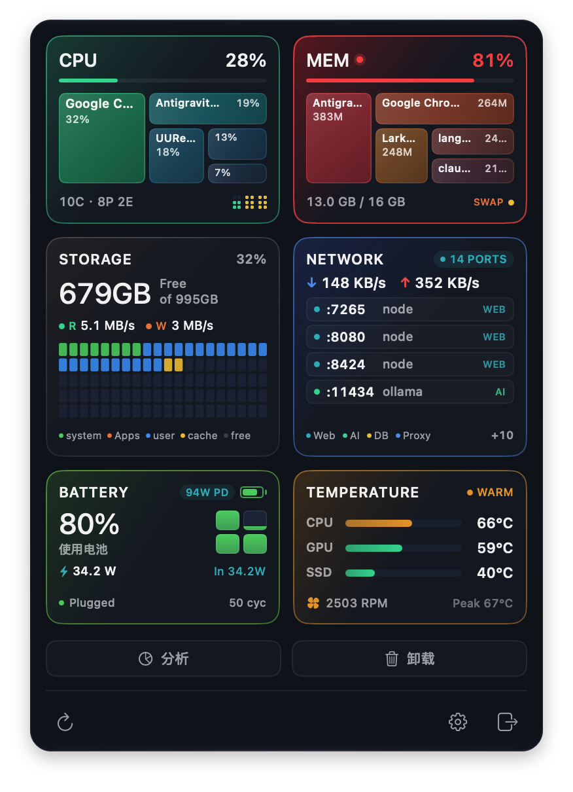
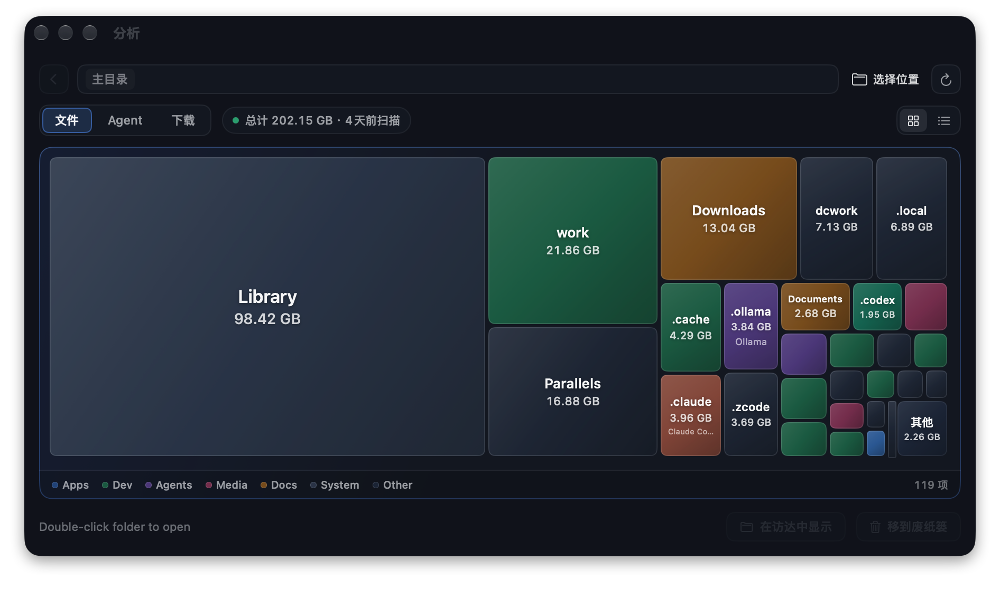
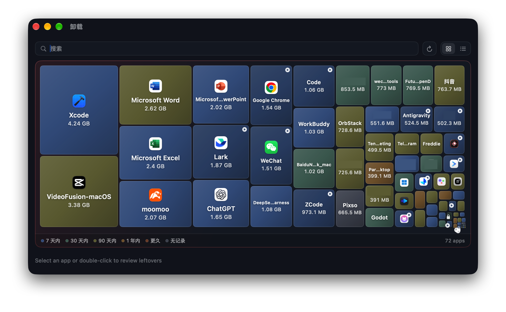

<div align="center">


# Peek

**A lightweight, native macOS menu bar app for real-time system telemetry, visual storage analysis, and clean app uninstallation.**

[](https://peek.yuntianyou.cc)
[](https://swift.org)
[](https://github.com/athlan20/peek/releases)
[](https://peek.yuntianyou.cc)

**English** · [简体中文](README.zh-CN.md)

</div>

---

## Overview

**Peek** lives quietly in your macOS menu bar and gives you an instant, high-density Bento dashboard of what your Mac is doing—along with interactive squarified treemaps to inspect disk usage, audit AI Agent footprints, and uninstall apps together with their leftover files.

Built with **100% native Swift & SwiftUI** (`MenuBarExtra`) and direct Darwin / IOKit system calls. **Zero external CLI dependencies, zero background daemons, and zero root privileges required.**

---

## Screenshots

### Bento Menu Bar Panel
A 6-card dark Bento grid presenting live hardware telemetry at a glance:

<div align="center">
  
</div>

### Interactive Storage & AI Agent Analyzer
Real-time streaming squarified treemap for folders, 19+ AI coding agents, and stale downloads:

<div align="center">
  
</div>

### Visual App Uninstaller
Treemap & list view of installed applications color-coded by last-used recency, with deep leftover detection:

<div align="center">
  
</div>

---

## Key Features

### 1. 6-Card Bento Telemetry Panel
- **CPU** — Total usage, P-core / E-core breakdown & visual core matrix, and mini treemap of top CPU processes.
- **Memory** — Activity Monitor-aligned used/total RAM, memory pressure & swap indicator, and top memory consumers.
- **Storage** — Free & total capacity, live disk Read/Write throughput (`R/W MB/s`), and a pixel matrix showing categorized usage (`system`, `Apps`, `user`, `cache`, `free`).
- **Network & Listening Ports** — Live download/upload speeds on the primary interface plus an automatic port table identifying active local services (`Web`, `AI`, `DB`, `Proxy`, e.g., `node`, `ollama`).
- **Battery & Live Power** — Charge percentage, power state, cycle count, 4-cell health matrix, USB-C PD adapter wattage, and real-time system power draw (`W`).
- **Thermal & Fan** — Live CPU, GPU, and SSD temperature gauges (`°C`), thermal state badge, fan speed (`RPM`), and peak temperature tracking.
- **Zero-Overhead Background Mode** — High-frequency sampling runs only while the popover is open; drops to near-zero CPU when closed.

### 2. Visual Disk & AI Agent Analyzer (`Analyze`)
- **Live Streaming Squarified Treemap** — Blocks grow and rearrange smoothly (`0.2s` snapshots) as scanning progresses. Drill down into subfolders even before a scan finishes.
- **Dedicated AI Agent Footprint Tab** — Automatically detects and aggregates cache, model, and session directories across **19+ AI tools & agents**, including:
  - *Claude Code / Claude*, *Codex*, *Gemini CLI*, *Cursor*, *Windsurf*, *Ollama*, *LM Studio*, *Hugging Face*, *GitHub Copilot*, *Kiro*, *Trae*, *Aider*, *Continue*, *opencode*, *Qwen Code*, *T3 Code*, *pi*, *WorkBuddy*, and *CodeBuddy*.
- **Stale Downloads Tab** — Surfaces items in `~/Downloads` untouched for over 90 days.
- **Pause, Resume & Persistent Cache** — Scans checkpoint automatically to `~/Library/Caches/Peek/analyze-cache.json`. Close the window or quit Peek anytime and resume right where you left off.
- **Color-Coded Categories** — Semantic coloring for `Apps`, `Dev` (`node_modules`, `DerivedData`, `.cargo`, etc.), `Agents`, `Media`, `Docs`, `System`, and `Other`.

### 3. Smart App Uninstaller (`Uninstall`)
- **Recency-Colored App Treemap** — Visualizes `/Applications` and `~/Applications` by size and colors each block by Spotlight `kMDItemLastUsedDate` (*≤7d*, *≤30d*, *≤90d*, *≤1y*, *>1y*, or *No record*).
- **Leftover & Residual Scanner** — Matches associated data across `~/Library` (`Application Support`, `Caches`, `Preferences`, `Containers`, `Saved Application State`, `HTTPStorages`, `Logs`) by Bundle ID and app name.
- **Safety Guards** — Protects system apps, running apps (indicated with a play badge), and Peek itself. Every removal previews all matched paths first and moves files to the **Trash** rather than permanently deleting them.

### 4. Native Experience & Built-in Updater
- **Instant Bilingual Switch** — Switch between **English**, **Simplified Chinese (简体中文)**, or **System Default** on the fly without restarting.
- **Graceful Permission Degradation** — Runs as a standard user without admin rights. **Full Disk Access** is completely optional (enables accurate sizing of protected containers and Safari/sandboxed folders).
- **Verified In-App Updater** — Checks GitHub Releases, matches your Mac's architecture (`arm64` / `x86_64`), and verifies both **SHA-256 checksums** and **code-signing certificate fingerprints** before atomic replacement.

---

## Installation

### Homebrew (Recommended)
```bash
brew install --cask athlan20/tap/peek
```

### Download Release
1. Download the latest `.dmg` for your Mac (`arm64` for Apple Silicon, `x86_64` for Intel) from [GitHub Releases](https://github.com/athlan20/peek/releases) or [peek.yuntianyou.cc](https://peek.yuntianyou.cc).
2. Open the `.dmg` and drag **Peek** into `Applications`.
3. Launch **Peek** from `Applications`.

### First-Launch Gatekeeper Note
Peek is signed with a persistent self-signed certificate (so your macOS privacy permissions are preserved across updates) rather than Apple Developer ID notarization. On first launch, macOS will show a security prompt:

1. Click **Done** on the prompt (do **not** click *Move to Trash*).
2. Open **System Settings → Privacy & Security**, scroll down to the **Security** section, and click **Open Anyway** next to Peek.
3. Confirm with Touch ID or your password, then open Peek again.

> **Tip:** If you don't see the *Open Anyway* button, clear the quarantine attribute in Terminal and launch Peek:
> ```bash
> xattr -dr com.apple.quarantine /Applications/Peek.app
> ```

---

## Building from Source

### Requirements
- **macOS 14.0 (Sonoma)** or later
- **Xcode 16+** (`xcode-select -p` must point to `/Applications/Xcode.app/Contents/Developer`)
- **XcodeGen**:
  ```bash
  brew install xcodegen
  ```

### Generate & Run
`Peek.xcodeproj` is generated from `project.yml` and is not tracked in Git:

```bash
# 1. Generate Xcode project (re-run after editing project.yml or adding/moving files)
xcodegen generate

# 2. Open in Xcode and run the "Peek" scheme
open Peek.xcodeproj

# 3. Or run the CLI Debug build & unit test verification script
tools/verify.sh
```

> **Note:** Debug builds use the display name **"Peek Dev"** and Bundle ID `cc.yuntianyou.peek.dev`, so they can run side-by-side with your installed release build of Peek without interfering with user data or permissions.

### Packaging Release Builds
```bash
# Package single-architecture Release DMG & ZIP archives into dist/
tools/package.sh --adhoc            # Ad-hoc signature for local testing
tools/package.sh                    # Official build (requires "Peek Self-Signed" certificate)
tools/package.sh --arch arm64       # Build Apple Silicon package only
```

---

## Architecture & Directory Layout

| Directory | Description |
| :--- | :--- |
| `Peek/App` | App entry point (`MenuBarExtra`) & menu bar status item |
| `Peek/Panel` | 6-card dark Bento popover panel, theme palette, and telemetry cards |
| `Peek/System` | Native Darwin / IOKit samplers (CPU, Memory, Disk, Network, Ports, Battery, Power, Thermal, Processes) |
| `Peek/Analyze` | Disk scanner, checkpoint cache, AI Agent footprint classifier, and Analyze window |
| `Peek/Uninstall` | App catalog, `~/Library` residual finder, and Uninstall window |
| `Peek/Treemap` | Pure-Swift squarified treemap layout engine and reusable interactive `TreemapView` |
| `Peek/Clean` | Safe path guard, measurement, and deletion rules |
| `Peek/History` | Local operation history store |
| `Peek/Settings` | Bilingual language manager, refresh interval, Login Item, Full Disk Access & update UI |
| `Peek/Update` | Native GitHub Releases updater with SHA-256 & certificate fingerprint verification |
| `Peek/Resources` | App icon, assets, and String Catalog (`Localizable.xcstrings` for EN & zh-Hans) |
| `PeekTests` | Unit test suite covering treemap layout, samplers, classifiers, cache, and rules |
| `Config` | Debug / Release `.xcconfig` signing configurations |
| `tools` | Build verification (`verify.sh`), packaging (`package.sh`), and worktree workflow scripts |
| `docs` | Detailed product & engineering specifications |

---

## Documentation

Detailed specifications and guides live in [`docs/`](docs/):
- [Installation Guide (EN / 中文)](docs/install.md)
- [Analyze & AI Agent Treemap Spec](docs/analyze-treemap.md)
- [Uninstall Treemap & Recency Spec](docs/uninstall-treemap.md)
- [Uninstall Residual Rules](docs/uninstall-rules.md)
- [Code Signing Guide](docs/signing.md)
- [Development & Worktree Workflow](docs/dev-test-workflow.md)

---

## Support

Enjoying Peek? [Buy the author a coffee ☕](https://peek.yuntianyou.cc/#sponsor)

---

Originally launched on the [Linux.do Community](https://linux.do/).
