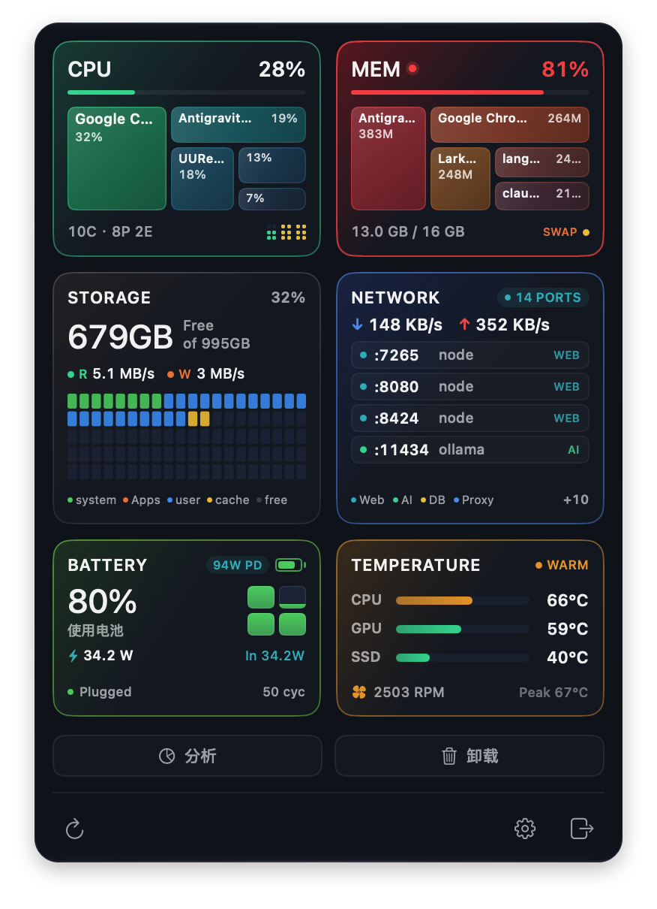
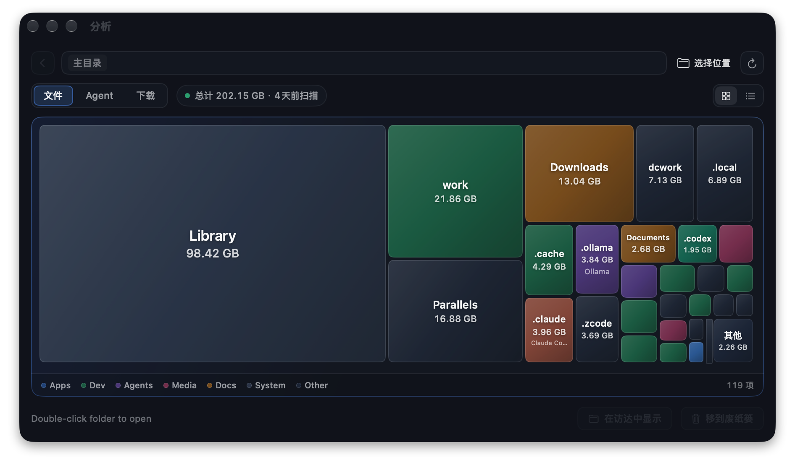
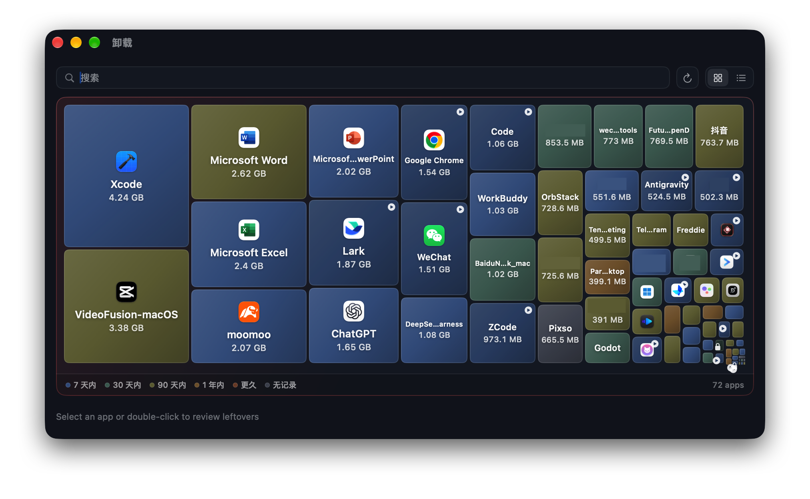

<div align="center">


# Peek

**轻量、原生的 macOS 菜单栏工具：实时硬件状态监控、可视化磁盘与 AI Agent 空间分析、应用彻底卸载。**

[](https://peek.yuntianyou.cc)
[](https://swift.org)
[](https://github.com/athlan20/peek/releases)
[](https://peek.yuntianyou.cc)

[English](README.md) · **简体中文**

</div>

---

## 简介

**Peek** 常驻于 macOS 菜单栏，点击即可展开高信息密度的暗色 **Bento 监控面板**，实时查看 Mac 的核心硬件状态；同时提供基于 **Squarified Treemap（方块矩阵图）** 的磁盘空间分析器、AI 编程工具/Agent 占用专页，以及支持残留清理的应用卸载器。

全项目使用 **100% 原生 Swift 与 SwiftUI**（`MenuBarExtra`）结合 Darwin / IOKit 系统接口实现。**不调用、不打包任何外部命令行工具，无后台常驻特权进程，无需管理员权限。**

---

## 界面预览

### Bento 菜单栏监控面板
6 张暗色 Bento 卡片，一屏展示核心硬件遥测与本地监听端口：

<div align="center">
  
</div>

### 磁盘与 AI Agent 空间分析
边扫边画的实时交互式方块视图，支持目录逐层下钻、19+ 种 AI Agent 占用聚合与久置下载文件排查：

<div align="center">
  
</div>

### 可视化应用卸载器
按体积排布应用方块、按最后使用时间着色，双击即可预览并连同 `~/Library` 残留一并移入废纸篓：

<div align="center">
  
</div>

---

## 核心特性

### 1. 6 卡片 Bento 菜单栏面板
- **CPU** — 总占用率、性能核/能效核（P/E Cores）构成与核心负载点阵、高占用进程迷你方块图。
- **内存 (MEM)** — 对齐“活动监视器”口径的已用/总内存、内存压力与 Swap 指示灯、高内存占用进程方块图。
- **存储 (STORAGE)** — 剩余与总容量、实时磁盘读写速率（`R/W MB/s`），以及按类别着色（`system`、`Apps`、`user`、`cache`、`free`）的容量像素矩阵。
- **网络与端口 (NETWORK)** — 默认网卡实时上下行速率，以及自动识别本地监听端口与服务类型（`Web`、`AI`、`DB`、`Proxy`，如 `node`、`ollama` 等）的端口表。
- **电池与实时功耗 (BATTERY)** — 电量百分比、充放电状态、循环次数、四格健康度矩阵、USB-C PD 充电器功率规格，以及整机实时功耗（`W`）。
- **温度与风扇 (TEMPERATURE)** — CPU、GPU、SSD 实时温度柱状条（`°C`）、温控状态徽标、风扇转速（`RPM`）及峰值温度记录。
- **后台零开销** — 仅在面板打开时高频采样；面板收起后立即停止高频采集，后台 CPU 占用接近 0。

### 2. 可视化磁盘与 AI Agent 分析 (`Analyze`)
- **边扫边画的方块视图** — 扫描开始后每 `0.2s` 输出快照，方块随扫描进度平滑生长与重排；无需等整盘扫完即可双击进入已出现的子文件夹。
- **AI Agent 专项分析页** — 自动识别并汇总 **19+ 款主流 AI 编程工具与本地模型**散落在主目录与资源库中的缓存、模型及会话体积：
  - 支持 *Claude Code / Claude*、*Codex*、*Gemini CLI*、*Cursor*、*Windsurf*、*Ollama*、*LM Studio*、*Hugging Face*、*GitHub Copilot*、*Kiro*、*Trae*、*Aider*、*Continue*、*opencode*、*Qwen Code*、*T3 Code*、*pi*、*WorkBuddy*、*CodeBuddy*。
- **久置下载清理** — 单独列出 `~/Downloads` 中超过 90 天未动过的大文件与安装包。
- **断点暂停与持久化缓存** — 扫描检查点与结果自动保存在 `~/Library/Caches/Peek/analyze-cache.json`。关闭窗口或重启应用后无需重头再扫，可随时从断点继续。
- **语义化分类着色** — 自动识别并区分 `Apps`（应用）、`Dev`（开发构建目录，如 `node_modules`、`DerivedData`、`.cargo` 等）、`Agents`、`Media`、`Docs`、`System` 与 `Other`。

### 3. 智能应用卸载 (`Uninstall`)
- **使用频率着色方块图** — 扫描 `/Applications` 与 `~/Applications`，方块面积对应体积，颜色按 Spotlight 最后使用时间分档（*7 天内*、*30 天内*、*90 天内*、*1 年内*、*更久*、*无记录*），一眼找出占空间又久未使用的应用。
- **深层残留关联** — 按 Bundle ID 与应用名自动匹配 `~/Library` 下的关联目录（`Application Support`、`Caches`、`Preferences`、`Containers`、`Saved Application State`、`HTTPStorages`、`Logs` 等）。
- **安全第一** — 系统内置应用、Peek 自身会加锁保护；正在运行的应用标有运行角标并提示先退出。所有卸载操作均先预览明细，确认后统一**移至废纸篓**，绝不静默直接抹除。

### 4. 原生体验与安全在线更新
- **中英双语即时切换** — 支持**简体中文**、**English** 或**跟随系统**，在设置中切换后立即生效，无需重启。
- **权限优雅降级** — 全程以普通用户身份运行。**完全磁盘访问权限（Full Disk Access）完全可选**，未授权时自动跳过受保护容器并平稳降级。
- **双重校验在线更新** — 内置轻量 GitHub Releases 更新器，自动匹配当前架构（`arm64` / `x86_64`），下载后同时校验 **SHA-256 摘要**与**代码签名证书指纹**，确保升级安全且系统授权不丢失。

---

## 安装指南

### Homebrew 安装（推荐）
```bash
brew install --cask athlan20/tap/peek
```

### 手动下载安装
1. 前往 [GitHub Releases](https://github.com/athlan20/peek/releases) 或官网 [peek.yuntianyou.cc](https://peek.yuntianyou.cc) 下载对应架构的 `.dmg` 安装包（Apple Silicon 选 `arm64`，Intel 选 `x86_64`）。
2. 双击打开 `.dmg`，将 **Peek** 拖入 `Applications`（应用程序）文件夹。
3. 在“应用程序”中双击打开 **Peek**。

### 首次打开被系统拦截的处理
Peek 采用固定的自签名证书签名（以保证版本升级后系统的隐私授权不会丢失），未走 Apple Developer ID 公证。首次打开时 macOS 会弹出安全提示，按以下步骤操作一次即可：

1. 在弹窗中点击 **“完成”**（不要点“移到废纸篓”）。
2. 打开 **系统设置 → 隐私与安全性**，向下滚动到“安全性”区域，找到关于 Peek 的提示并点击 **“仍要打开”**。
3. 使用触控 ID 或密码确认，再次打开 Peek 即可正常使用。

> **提示：** 如果在设置里没有看到“仍要打开”按钮，可在“终端”运行以下命令移除下载隔离标记后再打开：
> ```bash
> xattr -dr com.apple.quarantine /Applications/Peek.app
> ```

---

## 从源码构建

### 环境要求
- **macOS 14.0 (Sonoma)** 或更高版本
- **Xcode 16+**（`xcode-select -p` 需指向 `/Applications/Xcode.app/Contents/Developer`，不能仅安装 CommandLineTools）
- **XcodeGen**：
  ```bash
  brew install xcodegen
  ```

### 生成工程与运行
`Peek.xcodeproj` 由 `project.yml` 自动生成，不纳入 Git 版本库：

```bash
# 1. 生成 Xcode 工程（修改 project.yml、切换分支或增删文件后需重新执行）
xcodegen generate

# 2. 在 Xcode 中打开并运行 Peek scheme
open Peek.xcodeproj

# 3. 或使用命令行脚本编译 Debug 并运行校验
tools/verify.sh
```

> **说明：** Debug 构建名为 **"Peek Dev"**，Bundle ID 为 `cc.yuntianyou.peek.dev`，与正式版（`cc.yuntianyou.peek`）互不干扰，运行后仅在菜单栏显示图标，不在 Dock 显示。

### 打包发行版
```bash
# 编译单架构 Release 并生成 DMG 与 ZIP 到 dist/ 目录
tools/package.sh --adhoc            # 临时签名，仅用于本地测试打包流程
tools/package.sh                    # 正式打包（需钥匙串中有 "Peek Self-Signed" 证书）
tools/package.sh --arch arm64       # 仅打 Apple Silicon 单架构包
```

---

## 目录结构

| 目录 | 说明 |
| :--- | :--- |
| `Peek/App` | 应用入口（`MenuBarExtra`）与菜单栏图标管理 |
| `Peek/Panel` | 6 卡片暗色 Bento 弹出面板、主题色板与各监控卡片视图 |
| `Peek/System` | 原生 Darwin / IOKit 系统采集器（CPU、内存、磁盘、网络、端口、电池、功耗、温度、进程） |
| `Peek/Analyze` | 磁盘扫描器、断点缓存、AI Agent 占用识别器与磁盘分析窗口 |
| `Peek/Uninstall` | 应用扫描目录、残留文件匹配器与卸载窗口 |
| `Peek/Treemap` | 纯 Swift 实现的 Squarified Treemap 布局引擎与可复用方块视图组件 |
| `Peek/Clean` | 安全路径守卫、体积测算与清理执行器 |
| `Peek/History` | 本地历史记录存储 |
| `Peek/Settings` | 语言热切换、采样间隔、开机自启、完全磁盘访问状态与在线更新界面 |
| `Peek/Update` | 对接 GitHub Releases 的原生在线更新器（含 SHA-256 与证书指纹双重校验） |
| `Peek/Resources` | 应用图标、素材与多语言文案目录（`Localizable.xcstrings`，支持英文与简体中文） |
| `PeekTests` | 单元测试集（覆盖方块布局算法、采集器、分类器、缓存与安全规则） |
| `Config` | Debug / Release 的 `.xcconfig` 签名配置 |
| `tools` | 构建校验（`verify.sh`）、发行打包（`package.sh`）及多 worktree 开发脚本 |
| `docs` | 产品规格说明书与工程文档 |

---

## 相关文档

详细设计规格与使用说明见 [`docs/`](docs/) 目录：
- [安装与首次打开说明 (中英双语)](docs/install.md)
- [磁盘分析与 AI Agent 方块视图规格](docs/analyze-treemap.md)
- [应用卸载方块视图与使用频率着色规格](docs/uninstall-treemap.md)
- [应用卸载与残留匹配规则](docs/uninstall-rules.md)
- [自签名证书与签名说明](docs/signing.md)
- [开发与测试 Worktree 流程](docs/dev-test-workflow.md)

---

## 支持作者

喜欢这个项目？[请作者喝杯咖啡 ☕](https://peek.yuntianyou.cc/#sponsor)

---

项目首发于 [Linux.do 社区](https://linux.do/)。
